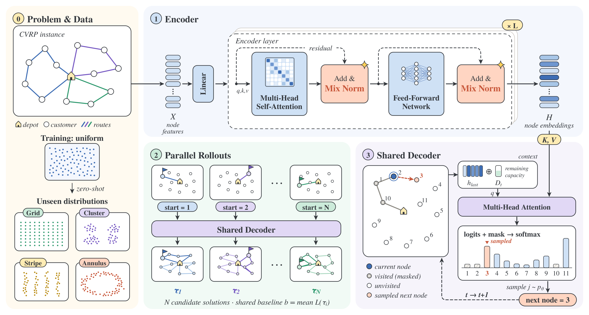

<div align="center">

# MixRoute

### Rethinking Single-Distribution Training for Generalizable Neural Routing

[](https://neurips.cc/)
[](https://arxiv.org/abs/2611.11977)
[](License.md)

**Hang Yi**<sup>1</sup> · **Ziwei Huang**<sup>1</sup> · **Yining Ma**<sup>2,✉</sup> · **Zhiguang Cao**<sup>1</sup>

<sup>1</sup>Singapore Management University &nbsp;&nbsp; <sup>2</sup>Massachusetts Institute of Technology

</div>

---

## 🔍 Overview

Neural solvers for routing problems often fail to generalize beyond their training distribution. Existing methods address this with multi-distribution training or meta-learning. We show that **single-distribution training** has been substantially underestimated, and that a simple architectural inductive bias can unlock it: **Mix Normalization**.

**MixRoute** replaces the normalization layers of the encoder with **Add & Mix Norm**. This layer adaptively combines Instance, Layer and Batch Normalization statistics through a learned gate, so the model can handle different kinds of distribution shift. Trained **only on uniform instances**, MixRoute generalizes zero-shot to a wide range of unseen distributions without any distribution-specific adaptation. It is evaluated on a benchmark of **179 datasets** over TSP, CVRP and CVRPTW, covering shifts in node coordinates, customer demands, capacity and time windows.

<p align="center">
  <a href="assets/framework.pdf"></a>
</p>

## 🏋️ Train

```bash
python TSP/POMO/train_n100.py
python CVRP/POMO/train_n100.py
python CVRPTW/POMO/train_n100.py
```

Models are trained on uniform instances of size 100. Checkpoints and logs are saved to `<PROBLEM>/POMO/result/`.

## 🧪 Test

```bash
python TSP/POMO/test_n100.py
python CVRP/POMO/test_distribution.py
python CVRPTW/POMO/test_ood_datasets.py
```

Each script evaluates the pretrained model in `pretrained/` on all test sets in `Dataset/` and prints the gap per dataset and per family. To test another checkpoint, change the model path at the top of the script.

## 📝 Citation

If you find this work useful, please consider citing:

```bibtex
@inproceedings{yi2026mixroute,
  title     = {MixRoute: Rethinking Single-Distribution Training for Generalizable Neural Routing},
  author    = {Yi, Hang and Huang, Ziwei and Ma, Yining and Cao, Zhiguang},
  booktitle = {Advances in Neural Information Processing Systems},
  year      = {2026}
}
```

